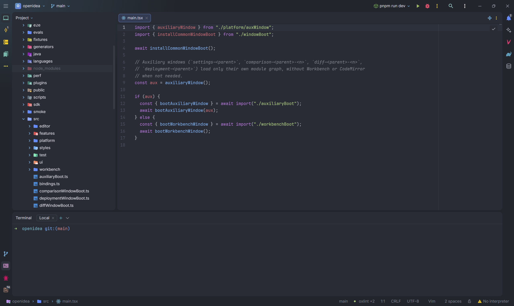

<h1 align="center">One Dark Pro for OpenIDEA</h1>

An unofficial OpenIDEA port of Binaryify's One Dark Pro, with five variants: 
One Dark Pro, Flat, Darker, Mix, and Night Flat.

More previews: [Flat](assets/one-dark-pro-flat.png), [Darker](assets/one-dark-pro-darkerpng.png), [Mix](assets/one-dark-pro-mix.png), and [Night Flat](assets/one-dark-pro-night-flat.png).

## Attribution

Original theme: [Binaryify/OneDark-Pro](https://github.com/Binaryify/OneDark-Pro).
Licensed under MIT; the original notice is included in [LICENSE.txt](LICENSE.txt).
